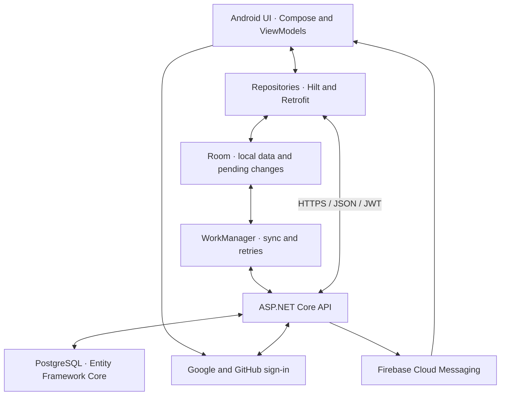

# DevLedger


**Personal Developer Utility & Asset Vault · PROG7314 Part 3 — Final Portfolio of Evidence**

DevLedger is a native Android application that brings a developer's reusable code, configuration templates and freelance finances into one place. The Snippet Vault helps organise development material, while the Financial Tracker records income, expenses and supporting attachments. Local storage and background synchronisation support continued work when connectivity is unavailable.

**Repository:** [Institutional GitHub repository](https://github.com/EMGPPT/prog7314-2026-poe-st10443021)  
**Changes since Part 2:** [Release notes](RELEASE_NOTES.md)

**Current status, 24 October 2026:** Part 3 feature and artwork changes are implemented. Institutional Android and API CI passed for commit `055bf26` on `blake`; downloaded reports confirm 151 Android and 68 API tests passing, zero Android lint errors and a matching debug-APK checksum. Blake has also confirmed successful verification after merging into `main`; the exact main commit and run links remain to be recorded below. Hamza's physical-device acceptance, the signed production release and final demonstration evidence remain pending.

## Team members

| Name | Student number |
|---|---|
| Blake Derek Godfrey | ST10435415 |
| Syed Muhammad Hamza Kazmi | ST10443021 |
| Connor Albertyn | ST10437293 |
| Muzammil Cassim | ST10259792 |

## 1. Purpose and features

DevLedger was designed in Part 1, prototyped in Part 2 and refined for Part 3. Its interface combines a developer asset vault with personal financial tracking, account settings and visibility into background work.

| Area | Available functionality |
|---|---|
| Authentication | Email registration/login, Google sign-in and GitHub OAuth through the custom API. |
| Device security | Native biometric verification, an app PIN fallback and account-specific biometric preferences. Enabling biometrics requires a successful native verification. |
| Snippet Vault | Code/configuration snippets, folders, tags, syntax-aware editing, line numbers, search, favourites, sharing, duplication and archiving. |
| Financial Tracker | Income/expense entries, categories, monthly summaries and charts, recurring transactions, receipt/invoice attachments and a configurable monthly budget. |
| Offline work | Room-backed local data, queued supported changes, WorkManager scheduling and synchronisation with the API after connectivity returns. |
| Sync recovery | Explicit conflict handling, a keep-both recovery option, retry controls and status that distinguishes queued work, failures and incomplete downloads. |
| Notifications | Firebase Cloud Messaging integration, retryable device registration and backend budget alerts triggered by direct transaction creation and batch synchronisation. |
| Languages | English, Afrikaans and isiXhosa resources across screens, validation, prompts and relevant messages; locale-aware formatting and notification text. |
| Preferences | Saved application settings, including language, security and synchronisation preferences such as Wi-Fi-only and charging-only operation. |
| Branding | Launcher, round and adaptive icons, a themed monochrome icon, notification icon and existing 512 × 512 store artwork. |

These are implementation descriptions. The acceptance checks in Section 7 remain the record of what has been demonstrated on a phone.

**Part 1 feature mapping — pending:** add the agreed Part 1 descriptions and evidence for rubric entries **User Defined 4** and **User Defined 5**. The Snippet Vault and Financial Tracker already exist; their rubric numbering must be confirmed against Part 1.

## 2. Architecture and design



**Client separation.** Compose screens render ViewModel state; repositories coordinate local persistence and API access. This keeps presentation, data access and background work separate (Android Developers, n.d.a).

**Offline persistence.** Supported edits are recorded locally and queued for upload. Room provides structured on-device storage, while WorkManager schedules persistent work subject to connectivity and saved constraints (Android Developers, n.d.b; n.d.c). Sync acknowledgement preserves a newer local edit made during an upload, and conflicts require an explicit recovery decision.

**Backend and identity.** The ASP.NET Core API uses EF Core/Npgsql for PostgreSQL persistence and JWT-protected endpoints (Microsoft, n.d.). Google ID tokens are verified by the server; GitHub authorisation codes are exchanged server-side. The GitHub client secret remains on the server (Google, n.d.; GitHub, n.d.a).

**Local verification.** AndroidX BiometricPrompt performs native biometric verification, with a separate app PIN fallback. The saved preference and per-account local registration state are reconciled. DevLedger does not collect fingerprint images; no claim is made that all vault data is encrypted by a biometric-bound key (Android Developers, n.d.d).

**Messages and alerts.** Translated resources are resolved for the selected language instead of storing English UI text in ViewModel state (Android Developers, n.d.e). Backend budget checks use the relevant UTC month and base currency, prepare threshold alerts within the database transaction and send after a successful commit. Firebase supplies the push transport (Firebase, n.d.a; n.d.b).

## 3. Repository layout

Paths below are relative to the **Git repository root**, which contains the outer `DevLedger` directory.

| Path | Contents |
|---|---|
| `README.md` | Project overview, setup and submission evidence. |
| `RELEASE_NOTES.md` | Part 3 functional changes and release status. |
| `.github/workflows/android-ci.yml` | Android debug build, unit tests, lint and artifact uploads. |
| `.github/workflows/api-ci.yml` | API restore, Release build, unit tests and test-report upload. |
| `DevLedger/android/` | Android Gradle project and wrapper. |
| `DevLedger/android/app/src/main/` | Kotlin sources, resources and Android manifest. |
| `DevLedger/android/app/src/test/` | Android local unit tests. |
| `DevLedger/api/DevLedger.Api/` | ASP.NET Core API, services and database migrations. |
| `DevLedger/api/DevLedger.Api.Tests/` | API automated tests. |
| `Dockerfile` | API container build definition. |

GitHub Actions workflows now live in `.github/workflows/` at the repository root, where GitHub discovers them (GitHub, n.d.b). Their commands use the nested Android/API project paths described above.

## 4. Technology and prerequisites

| Component | Project configuration / requirement |
|---|---|
| Android client | Kotlin, Jetpack Compose, MVVM, Hilt, Retrofit, Room and WorkManager. |
| Android tooling | Android Studio, Android SDK 34 and the checked-in Gradle wrapper. |
| Java | JDK 21 for the configured Gradle daemon; Android Java/Kotlin compilation targets Java 17. |
| Device | Android 8.0 / API 26 minimum. Compile/target SDK is currently 34; these values do not establish current Play submission eligibility. |
| API | .NET 10 SDK, ASP.NET Core and Entity Framework Core 10. |
| Database | PostgreSQL through the Npgsql provider. |
| Identity and push | Google/GitHub OAuth configuration; Firebase Android configuration and server-side Firebase Admin credentials. |
| Hosting | Render API deployment configuration and PostgreSQL persistence; recheck deployment linkage after the repository move (Render, n.d.). |
| Tests | Android JUnit/MockK/Turbine and related test libraries; API xUnit and Fluent Assertions. |
| Source control | Git and the institutional GitHub repository. |

### Environment configuration

Use the existing project configuration for the team's deployment, or supply matching values for a separate environment.

| Setting | Where to configure it |
|---|---|
| API base URL | `BASE_URL` in `DevLedger/android/app/build.gradle.kts`. The reviewed configuration uses `https://devledger-api-op1w.onrender.com/`. Reachability must be checked before the final demonstration. |
| Google OAuth | Android `GOOGLE_WEB_CLIENT_ID` and server `Google:WebClientId` / `Google__WebClientId` must match the intended web client. Register the Android package and signing-certificate fingerprints with the provider. |
| GitHub OAuth | Android `GITHUB_CLIENT_ID` and server `GitHub:ClientId` / `GitHub__ClientId`; keep `GitHub:ClientSecret` / `GitHub__ClientSecret` server-side. Callback: `devledger://oauth/github/callback`. |
| Firebase Android app | Provide the environment's valid `DevLedger/android/app/google-services.json` for `com.devledger.app`. This is client configuration, distinct from a service-account private key. |
| Database | Server `ConnectionStrings:DefaultConnection` / `ConnectionStrings__DefaultConnection`. |
| JWT | Server `Jwt:SigningKey` / `Jwt__SigningKey` and `Jwt:Issuer` / `Jwt__Issuer`. Use a private signing key for the intended environment. |
| Firebase Admin | Server `Firebase:CredentialsPath` / `Firebase__CredentialsPath` pointing to a securely provisioned service-account file. Without valid server configuration, push delivery is unavailable. |

The colon form is used in .NET configuration/user-secrets; the double-underscore form is suitable for environment variables. Keep database credentials, JWT signing keys, OAuth client secrets, service-account keys and Android signing keys out of source control. OAuth client IDs and Firebase Android configuration identify client applications; they are not substitutes for server credentials.

## 5. Build and run

### Get the source

For a new checkout:

```powershell
git clone https://github.com/EMGPPT/prog7314-2026-poe-st10443021.git
Set-Location .\prog7314-2026-poe-st10443021
```

If the repository is already cloned, use that checkout. Open `DevLedger/android` in Android Studio, let it resolve the SDK path, and supply the configuration above. The commands below reset to the Git root so they also work when the terminal is inside a project subfolder.

### Android build, unit tests and lint

```powershell
Set-Location (git rev-parse --show-toplevel)
Set-Location .\DevLedger\android
.\gradlew.bat :app:assembleDebug :app:testDebugUnitTest :app:lintDebug
```

On macOS/Linux, use `./gradlew` from `DevLedger/android`.

| Output | Path from repository root |
|---|---|
| Debug APK | `DevLedger/android/app/build/outputs/apk/debug/app-debug.apk` |
| Unit-test report | `DevLedger/android/app/build/reports/tests/testDebugUnitTest/index.html` |
| Lint report | `DevLedger/android/app/build/reports/lint-results-debug.html` |

Install/run from Android Studio on a physical phone for acceptance testing. The debug APK is a development build; production signing and release installation are separate pending checks.

### API restore, build and test

```powershell
Set-Location (git rev-parse --show-toplevel)
dotnet restore .\DevLedger\api\DevLedger.Api.Tests\DevLedger.Api.Tests.csproj
dotnet build .\DevLedger\api\DevLedger.Api.Tests\DevLedger.Api.Tests.csproj --no-restore
dotnet test .\DevLedger\api\DevLedger.Api.Tests\DevLedger.Api.Tests.csproj --no-build
```

To run a configured local API:

```powershell
Set-Location (git rev-parse --show-toplevel)
dotnet run --project .\DevLedger\api\DevLedger.Api\DevLedger.Api.csproj
```

The API applies pending EF Core migrations on startup; point it at the intended database before starting it. A phone needs a reachable API address and valid HTTPS configuration. Its `localhost` is the phone itself, so update the Android base URL appropriately when using a local API.

## 6. Version control, CI and release management

Development history has been transferred to the institution's repository. Continue meaningful commits and reviews there; the most recently supplied development branch was `blake`. The final submission must identify the exact tested commit and retain the contributors' genuine history.

### Automated checks

Both root-level workflows run on every remote push, on pull requests and by manual dispatch, without the previous branch/path filters.

| Workflow | Runner configuration and checks | Uploaded artifacts |
|---|---|---|
| Android CI | Ubuntu runner; Temurin JDK 21; Android SDK 34; checked-in Gradle 8.9 wrapper; tracked Firebase client configuration checked for `com.devledger.app`; debug assembly, local unit tests and lint. Java/Kotlin bytecode targets remain 17. | `android-unit-test-results`, `android-lint-report`, `devledger-debug-apk` (APK plus SHA-256 sidecar). |
| API CI | Ubuntu runner; .NET 10 SDK; explicit test-project restore, Release build and unit-test execution. | `api-test-results` containing `api-tests.trx`. |

The official POSIX Gradle launcher replaced the script that failed on Linux. Git tracks its executable permission and enforces LF line endings. Android lint now uses `abortOnError = true`, so detected errors fail the lint task. `checkReleaseBuilds = true` also restores fatal lint checks during release builds; the debug CI run does not verify release packaging or installation (Android Developers, n.d.f). Warnings remain visible and are not promoted to errors.

### Recorded CI evidence — 24 October 2026

| Evidence | Revision / result | Link or follow-up |
|---|---|---|
| Android CI #3 | `055bf26`, branch `blake`: passed; 151 tests passed, 0 failed, 0 skipped; lint reported 0 errors and 211 warnings. | [Successful Android run](https://github.com/EMGPPT/prog7314-2026-poe-st10443021/actions/runs/40089993728) |
| API CI #3 | `055bf26`, branch `blake`: passed; 68 tests passed, 0 failed, 0 skipped. | [Successful API run](https://github.com/EMGPPT/prog7314-2026-poe-st10443021/actions/runs/40089993753) |
| Main branch verification | Merge and verification confirmed successful by Blake on 24 October 2026. | Exact main commit: **Pending**; Android run URL: **Pending**; API run URL: **Pending**. These are distinct from the branch runs linked above. |

The downloaded JUnit XML, TRX and lint XML were inspected; both test reports contain the stated individual passing results. All four artifact archives passed ZIP integrity checks. The debug APK also passed archive integrity checking, and its calculated SHA-256 matched the uploaded sidecar:

```text
ac0f56a80caf40ff980b10142f08b03a66852b807a7fabaa5d259eafdea3b370
```

This checksum identifies the debug artifact from the recorded `055bf26` run; it is not a signed production APK or the checksum of a later main/release build.

**Artifact retention:** the institutional repository currently limits artifacts to **one day**, overriding the workflows' requested 30 days. Download all four artifacts promptly from the run summary before expiry (GitHub, n.d.c). Keep the downloaded evidence outside the source repository and record the associated commit/run URLs. Blake cannot change the repository retention settings with his current access; the limit does not prevent builds or downloads.

**Actions page:** [Institutional repository Actions](https://github.com/EMGPPT/prog7314-2026-poe-st10443021/actions).

Tag the final tested deployment commit only after release verification. Record the actual tag below; a valid identifier such as `final-poe` can carry a “Final POE” annotation. No final tag or release is claimed by this README.

## 7. Verification

The table distinguishes inspected automated reports from checks still requiring device/release evidence. Section 6 records the source revision and run URLs; final release results must be captured for the final tested revision.

| Check | Latest supplied result | Remaining evidence |
|---|---|---|
| Android debug assembly and unit tests | Institutional CI passed for `055bf26`; inspected XML confirms 151 passed, 0 failed, 0 skipped across 26 suites. The local command also completed successfully after enabling lint failures. | Record the main commit/run URLs and final-release results. |
| Android lint | Inspected CI XML: 0 errors, 211 warnings. Errors now fail the lint task. | Review warnings and run the relevant release checks; this is not a warning-free result. |
| API automated tests | Institutional CI passed for `055bf26`; inspected TRX confirms 68 passed, 0 failed, 0 skipped on .NET 10. | Record the main commit/run URLs and final-release results. |
| Uploaded CI artifacts | Android test and lint reports, debug APK/checksum and API TRX downloaded and inspected; archive integrity and APK checksum passed. | Preserve main/final-release evidence before the one-day expiry. |
| Whitespace check | Earlier `git diff --check` outputs reported no whitespace errors; Windows LF/CRLF conversion warnings were observed. | Repeat for these documentation changes and the final source. |
| Language resource parity | Static audit: 610 named strings and 8 plural resources in each of English, Afrikaans and isiXhosa. | Fluent-speaker review, layout and persistence checks on the phone. |
| Physical-device acceptance | Assigned to Hamza; results pending. | Phone model, Android version, build/commit, dates and outcomes. |
| Signed production release | Pending. | Version/signing details, release build, installation/regression results and matching commit/tag. |

Most lint warnings concern unused resources, dependency updates, version-catalog use and typography. Targeted review items also include date formatting without an explicit locale, App Bundle language splitting, device identifiers and backup rules. Earlier local API build warnings concerned deprecated Google credential loading, deprecated Firebase message-token use and a nullable folder-dictionary key; passing tests do not establish a warning-free build.

Physical-device acceptance must cover:

- SSO, invalid input, biometric success/failure/cancellation, unavailable or unenrolled biometrics, PIN fallback, account changes and restart.
- Offline create/edit/delete on supported records, reconnection, retry, concurrent edits, conflict recovery and visible backend results.
- Actual backend-originated FCM delivery in foreground/background, denied notification permission and account/token changes.
- Language switching across screens/messages, restart persistence and longer translations.
- Launcher/round/themed icon rendering, notification icons and the final signed APK.

**Final test evidence location:** Pending — add the actual report or repository path after it exists.

## 8. Known limitations and assessment follow-up

- **Session renewal:** the reviewed `/api/auth/refresh` endpoint still returns an unauthorised response instead of rotating refresh tokens. A rejected renewal requires sign-in again.
- **Attachments and storage:** attachments currently use Base64 data in PostgreSQL rather than dedicated blob storage. The reviewed implementation uses SQL, not NoSQL. Confirm how the brief's blob/NoSQL objectives will be satisfied or clarified with the lecturer; this README does not claim those services exist.
- **Currency conversion:** the reviewed Android converter uses a manually maintained approximate rate table. Live exchange-rate refresh has not been established.
- **Push delivery:** configured Firebase credentials, a registered device, connectivity and notification permission are required. A local notification record or successful database write alone does not demonstrate delivery.
- **Translation boundaries:** user-entered content is preserved. Provider-controlled/system dialogs follow their own localisation, and previously delivered notification text is not rewritten when the language changes.
- **Release readiness:** automated CI has passed and its branch artifacts have been inspected. Record the confirmed main verification links; device acceptance, current store requirements, final versioning/signing and final deployment verification remain open.

## 9. Screenshots and demonstration

The app icon above is existing project artwork. Add actual screenshots of the tested build below; no screen evidence is implied by the placeholders.

| Evidence to add | Image / evidence location |
|---|---|
| Sign-in and biometric/PIN flow | Pending — add screenshot(s) and caption. |
| Snippet Vault, editor and organisation | Pending — add screenshot(s) and caption. |
| Financial Tracker, summary and attachments | Pending — add screenshot(s) and caption. |
| Offline action, sync recovery and backend result | Pending — add screenshot(s) and caption. |
| Server-originated budget notification | Pending — add screenshot(s) and caption. |
| Afrikaans and isiXhosa screens | Pending — add screenshot(s) and caption. |
| Launcher, round/themed icon and store material | Pending — add screenshot(s) and caption. |

### Final demonstration video

**Status:** Not yet recorded.  
**Video URL:** Pending — add the final accessible link after recording.  
**Recording date / demonstrated build:** Pending.

The narrated demonstration must show the application running on a **physical phone**: SSO and biometric verification, changing/saving settings, communication with the hosted REST API, an offline action followed by successful reconnection/sync, visible API/database changes and the Part 1 user-defined features. Include truthful evidence of the deployed authentication flow; a Firebase dependency alone does not establish a Firebase Authentication flow. Use suitable demonstration data and hide credentials.

## 10. Final release and submission checklist

| Item | Value / evidence to add |
|---|---|
| Release version and version code | Pending. Reviewed Android values remain `1.0.0-prototype` / `1`. |
| Release date | Pending. |
| Final tested commit SHA | Pending. |
| Final POE tag and release page | Pending — add the actual tag and URL. |
| Signed production APK | Pending — add the release asset location and SHA-256 checksum. |
| Phone acceptance sign-off | Pending — add device/build details and results. |
| Promotional screenshots / publication preparation | Pending — add the completed material and evidence. |
| User Defined 4 / 5 mapping | Pending — confirm against Part 1 and add evidence. |
| AI-use write-up | Pending — add the actual document/path; maximum 500 words, describing actual use with citations. |
| Final video | Pending — complete Section 9 after recording. |

Before submission, align the README, release notes, passing checks, APK and final tag to the same tested revision. Submit organised source directly in Git, without compressed patch/source archives, generated build output or private credentials.

## References

Author-date references retain the original README's Harvard-style approach. Original sources were consulted on 22 October 2026, with lint and artifact-download references added on 24 October 2026. These sources describe platform behaviour and do not certify DevLedger's deployment or test outcomes.

- Android Developers, n.d.a. *Guide to app architecture*. [Online] Available at: [developer.android.com/topic/architecture](https://developer.android.com/topic/architecture) [Accessed 22 October 2026].
- Android Developers, n.d.b. *Save data in a local database using Room*. [Online] Available at: [developer.android.com/training/data-storage/room](https://developer.android.com/training/data-storage/room) [Accessed 22 October 2026].
- Android Developers, n.d.c. *Task scheduling*. [Online] Available at: [developer.android.com/develop/background-work/background-tasks/persistent](https://developer.android.com/develop/background-work/background-tasks/persistent) [Accessed 22 October 2026].
- Android Developers, n.d.d. *Show a biometric authentication dialog*. [Online] Available at: [developer.android.com/identity/sign-in/biometric-auth](https://developer.android.com/identity/sign-in/biometric-auth) [Accessed 22 October 2026].
- Android Developers, n.d.e. *Localize your app*. [Online] Available at: [developer.android.com/guide/topics/resources/localization](https://developer.android.com/guide/topics/resources/localization) [Accessed 22 October 2026].
- Android Developers, n.d.f. *Lint: Android Gradle Plugin 8.6 DSL reference*. [Online] Available at: [developer.android.com/reference/tools/gradle-api/8.6/com/android/build/api/dsl/Lint](https://developer.android.com/reference/tools/gradle-api/8.6/com/android/build/api/dsl/Lint) [Accessed 24 October 2026].
- Firebase, n.d.a. *Get started with Firebase Cloud Messaging in Android apps*. [Online] Available at: [firebase.google.com/docs/cloud-messaging/android/get-started](https://firebase.google.com/docs/cloud-messaging/android/get-started) [Accessed 22 October 2026].
- Firebase, n.d.b. *Add the Firebase Admin SDK to your server*. [Online] Available at: [firebase.google.com/docs/admin/setup](https://firebase.google.com/docs/admin/setup) [Accessed 22 October 2026].
- GitHub, n.d.a. *Authorizing OAuth apps*. [Online] Available at: [docs.github.com/en/apps/oauth-apps/building-oauth-apps/authorizing-oauth-apps](https://docs.github.com/en/apps/oauth-apps/building-oauth-apps/authorizing-oauth-apps) [Accessed 22 October 2026].
- GitHub, n.d.b. *Workflows*. [Online] Available at: [docs.github.com/en/actions/concepts/workflows-and-actions/workflows](https://docs.github.com/en/actions/concepts/workflows-and-actions/workflows) [Accessed 22 October 2026].
- GitHub, n.d.c. *Downloading workflow artifacts*. [Online] Available at: [docs.github.com/en/actions/how-tos/manage-workflow-runs/download-workflow-artifacts](https://docs.github.com/en/actions/how-tos/manage-workflow-runs/download-workflow-artifacts) [Accessed 24 October 2026].
- Google, n.d. *Authenticate with a backend server*. [Online] Available at: [developers.google.com/identity/sign-in/android/backend-auth](https://developers.google.com/identity/sign-in/android/backend-auth) [Accessed 22 October 2026].
- Microsoft, n.d. *ASP.NET documentation*. [Online] Available at: [learn.microsoft.com/en-us/aspnet/core/?view=aspnetcore-10.0](https://learn.microsoft.com/en-us/aspnet/core/?view=aspnetcore-10.0) [Accessed 22 October 2026].
- Render, n.d. *Web Services*. [Online] Available at: [render.com/docs/web-services](https://render.com/docs/web-services) [Accessed 22 October 2026].
