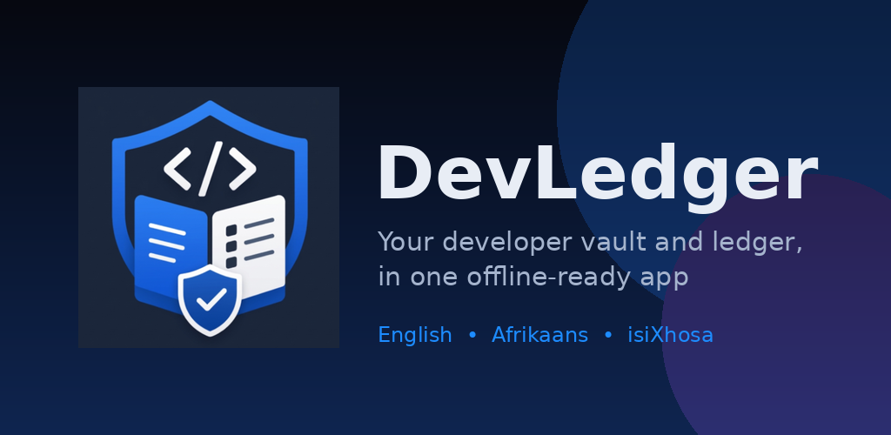
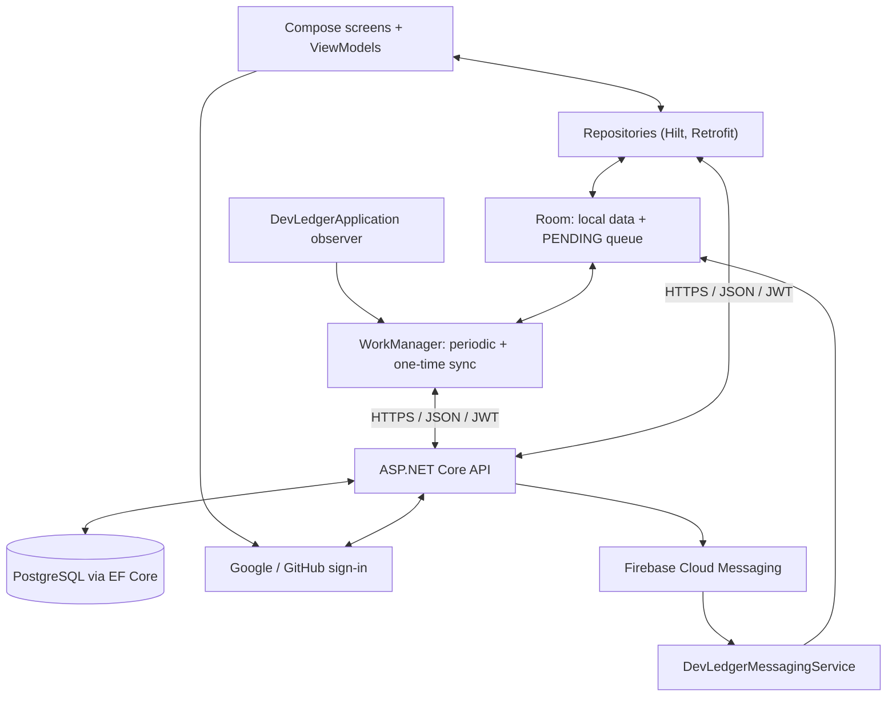
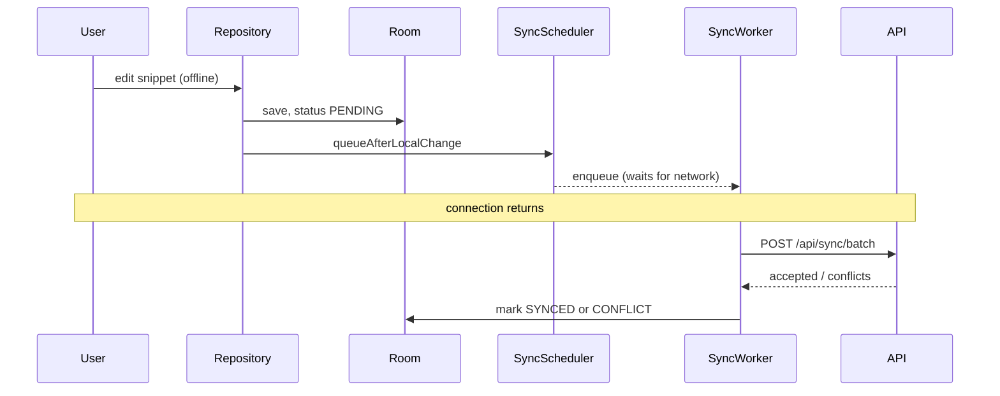
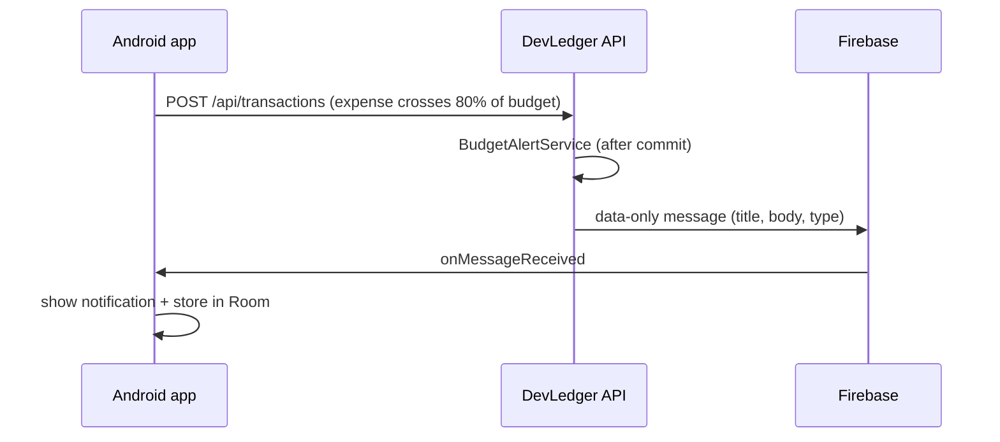

# DevLedger

<p align="center">
  
</p>

[](https://github.com/EMGPPT/prog7314-2026-poe-st10443021/actions/workflows/android-ci.yml)
[](https://github.com/EMGPPT/prog7314-2026-poe-st10443021/actions/workflows/api-ci.yml)

**Personal Developer Utility and Asset Vault** · PROG7314 Final Portfolio of Evidence · Technical report

> **Demonstration video:** [Watch on YouTube (unlisted)](https://youtu.be/REPLACE_WITH_VIDEO_ID)
> **Release notes:** [RELEASE_NOTES.md](RELEASE_NOTES.md) · **AI-use write-up:** [AI_USE_WRITEUP.md](AI_USE_WRITEUP.md) · **Code references:** [REFERENCES-CODE.md](REFERENCES-CODE.md)

## Contents
1. [Abstract](#1-abstract)  2. [Team](#2-team)  3. [Requirements and rubric mapping](#3-requirements-and-rubric-mapping)  4. [Architecture](#4-architecture)  5. [Feature design](#5-feature-design-and-design-considerations)  6. [REST API](#6-rest-api)  7. [DevOps](#7-devops-and-version-control)  8. [Testing](#8-testing)  9. [Release and Play Store readiness](#9-release-and-play-store-readiness)  10. [Setup](#10-setup-and-configuration)  11. [Screenshots](#11-screenshots)  12. [Limitations](#12-known-limitations)  13. [References](#13-references)

## 1. Abstract

DevLedger is a native Android app (Kotlin, Jetpack Compose) that keeps a developer's reusable code and freelance finances in one place. The **Snippet and Config Vault** stores code, scripts, regex and configuration templates in folders and tags. The **Financial Tracker** records freelance income and hosting or tool costs, with a monthly budget that triggers push alerts. A custom ASP.NET Core REST API with PostgreSQL provides sign-in (email, Google, GitHub), cloud sync and Firebase Cloud Messaging push. Everything works offline: changes are saved to Room and synchronised by WorkManager when a connection returns. The interface is available in English, Afrikaans and isiXhosa.

## 2. Team

| Name | Student number |
|---|---|
| Blake Derek Godfrey | ST10435415 |
| Syed Muhammad Hamza Kazmi | ST10443021 |
| Connor Albertyn | ST10437293 |
| Muzammil Cassim | ST10259792 |

## 3. Requirements and rubric mapping

| Rubric criterion (marks) | Where it is implemented | Evidence |
|---|---|---|
| App runs on a physical device (5) | Release build, `targetSdk` 36; invalid input is validated in view models and repositories | Demonstration video; Section 8 |
| Biometric authentication (10) | `BiometricAuthHelper`, `BiometricKeyManager` (Keystore-bound), `PinStorage`, `PinLockoutPolicy` | Video; unit tests in `security/` |
| Offline mode with sync (10) | Room entities, `SyncScheduler`, `SyncWorker`, `DevLedgerApplication` preference observer | Video (airplane-mode demo); `repository/` and `sync/` tests |
| Real-time notifications (10) | `DevLedgerMessagingService`, `NotificationsController`, `NotificationService`, `BudgetAlertService` | Video (live push); API tests |
| Multi-language (10) | `values/`, `values-af/`, `values-xh/` (640 strings, 8 plurals each) | Video; `localization/` tests |
| **User Defined 4:** Snippet and Config Vault (10) | `ui/screens/snippets`, `ui/screens/folders`, `SnippetRepository`, `FolderRepository`, `UserTagRepository` | Video; repository tests |
| **User Defined 5:** Developer Financial Tracker (10) | `ui/screens/finance`, `TransactionRepository`, budget in Settings, `BudgetAlertService` | Video; `FinanceUiStateTest`, `BudgetInputTest` |
| User interface (10) | Single design system in `ui/theme` and `ui/components`; every control wired | Section 11 |
| Play Store preparation (5) | Section 9, `store/`, signed APK/AAB from CI | GitHub Release assets |
| AI-use write-up (5) | [AI_USE_WRITEUP.md](AI_USE_WRITEUP.md) | |
| GitHub, README, automated testing (10) | Section 7; `.github/workflows/` | Actions tab, commit history |
| Demonstration video (5) | Link at the top of this file | |

**Learning outcomes.** Blob storage and a NoSQL database are PoE outcomes but are not separate rubric lines. DevLedger stores receipt attachments as Base64 text in PostgreSQL and uses a relational database; it does not use a dedicated blob service or a NoSQL store. This is declared openly (Section 12) rather than claimed.

## 4. Architecture



**Client layers.** Screens render ViewModel state; repositories combine Room and Retrofit; Hilt wires them (Google Developers, n.d.a; n.d.o). User-facing text lives in `UiText`/resources so the language can change without rebuilding state.

**Offline-first sync.** Every write goes to Room first with `syncStatus = PENDING`, then `SyncScheduler.queueAfterLocalChange` queues a one-time job if automatic sync is on. `DevLedgerApplication` observes the signed-in user and the saved sync preferences and schedules or cancels the periodic job, so the schedule is correct at start-up, after login and after any settings change (Google Developers, n.d.c; n.d.l).



**Push notifications.** The API sends data-only, high-priority FCM messages. The app is therefore always invoked, shows the system notification and writes it to Room, whether it is in the foreground or the background (Firebase, n.d.a). A tap opens the Notifications list once the user is past the PIN/biometric gate.



## 5. Feature design and design considerations

**Biometric authentication.** AndroidX BiometricPrompt (strong class only) is bound to an AES key in the Android Keystore created with `setUserAuthenticationRequired(true)` and `setInvalidatedByBiometricEnrollment(true)`. A scan only counts if the key then performs an operation, and adding a new biometric invalidates the key (Google Developers, n.d.d; n.d.m). The 4-digit PIN fallback is hashed with a salt, kept in EncryptedSharedPreferences, never sent to the server, and locks after five wrong entries (30 s, 1, 5, 15, 30 min) because a 4-digit PIN has only 10,000 combinations (OWASP Foundation, n.d.a).

**Offline mode.** Room is the source of truth. Conflicts are explicit, with a keep-both option; a newer edit made during an upload stays pending. Users choose automatic or manual sync, Wi-Fi only, charging only and the interval (15 minutes or more, the WorkManager minimum). Turning automatic sync off means changes wait for **Sync now**.

**Real-time notifications.** Budget alerts at 80% and 100% are evaluated on the server after the database transaction commits, for both direct entries and offline-synced batches. A test endpoint and button send a real push on demand.

**Multi-language.** English, Afrikaans and isiXhosa through string resources and per-app locale; server messages are localised too (Google Developers, n.d.r).

**Snippet and Config Vault.** Folders, tags, favourites, archive and recycle bin; folders and tags are renamed or deleted from a three-dot menu, with tag changes applied to every affected snippet and synced.

**Financial Tracker.** Income and expense entries, categories, charts, recurring transactions, attachments and a monthly budget (set in Settings, cached offline) shown as a progress bar.

**Security design decisions.** HTTPS only in release builds; debug logs never include request bodies; the API requires a real JWT key, rate limits authentication, hides Swagger in production and does not store PIN material (Section 6).

## 6. REST API

Base URL: `https://devledger-api-op1w.onrender.com/`. All routes except `/api/auth/*` need a Bearer JWT.

| Method and route | Purpose |
|---|---|
| `POST /api/auth/register`, `/login`, `/sso`, `/refresh` | Email and SSO sign-in; refresh rotates a signed 30-day refresh token. Rate limited. |
| `GET/PUT /api/users/me` | Profile and biometric preference (PIN is device-only) |
| `GET/PUT /api/settings` | Language, biometric, Wi-Fi-only, base currency, **monthly budget** |
| `GET/POST/PUT/DELETE /api/folders`, `GET /api/tags` | Folder and tag catalogue |
| `GET/POST/PUT/DELETE /api/snippets`, `GET /api/snippets/snapshot` | Snippets |
| `GET/POST /api/transactions`, `/summary`, `/daily-series`, `/category-breakdown`, `/{id}/attachment` | Finance |
| `POST /api/sync/batch`, `GET /api/sync/deletions` | Offline queue upload and deletion feed |
| `POST /api/notifications/register`, `POST /api/notifications/test` | FCM device registration; live test push |

Secrets are configuration only: `Jwt__SigningKey` (required, 32+ characters), `ConnectionStrings__DefaultConnection`, `Google__WebClientId`, `GitHub__ClientId/ClientSecret`, `Firebase__CredentialsPath`. See `DevLedger/api/DevLedger.Api/appsettings.json.example`.

## 7. DevOps and version control

- **Repository:** [EMGPPT/prog7314-2026-poe-st10443021](https://github.com/EMGPPT/prog7314-2026-poe-st10443021). Commit small, descriptive changes under each member's own identity (`feat:`, `fix:`, `docs:`, `test:`); never rewrite history.
- **Android CI** (`.github/workflows/android-ci.yml`) on every push and pull request: debug build, unit tests, lint **and a minified release build** (R8), then uploads reports and the debug APK with a SHA-256.
- **API CI** (`api-ci.yml`): restore, Release build and xUnit tests on .NET 10.
- **Signed release** (`release.yml`): pushing the tag `Final-POE` builds the signed APK and AAB, verifies the signature with `apksigner`, and attaches them with checksums to a GitHub Release.
- **Secrets** (repository settings, never committed): `KEYSTORE_BASE64`, `KEYSTORE_PASSWORD`, `KEY_ALIAS`, `KEY_PASSWORD`, `GOOGLE_SERVICES_JSON_B64`.
- **Final tag:** `git tag -a Final-POE -m "Final PoE submission" && git push origin Final-POE`.
- **Gate:** `bash scripts/verify-submission.sh` checks the PoE checklist before you submit.

## 8. Testing

Automated tests run on every push (static count: 169 Android unit-test methods in 29 suites; 83 API test cases). Android uses JUnit, MockK, Truth, Turbine and Robolectric; the API uses xUnit and FluentAssertions. Coverage includes repositories, sync, biometrics and PIN storage, lock-out policy, budget parsing, finance state, localisation parity, token and refresh handling, budget alerts and the localised push text. Logging uses `android.util.Log` (and `ILogger` on the API) throughout to show lifecycle and state changes.

Manual acceptance on a physical phone is shown in the demonstration video (Section 3).

## 9. Release and Play Store readiness

| Item | Status |
|---|---|
| Target API 36, version 1.0.0 (code 100) | Done (Google Play Console Help, n.d.) |
| Release signing, R8 rules, no cleartext, all languages in the bundle | Done in `app/build.gradle.kts`, `proguard-rules.pro` |
| Signed APK + AAB | Built by the `Signed release` workflow; attached to the GitHub Release |
| Listing text, data-safety answers, content-rating notes | `store/listing.md` |
| Privacy policy | `docs/privacy-policy.md` (host it and put the URL in the listing) |
| Icon (512 px), feature graphic (1024x500) | `DevLedger/android/app/src/main/ic_launcher-playstore.png`, `store/feature-graphic-1024x500.png` |
| Promotional screenshots | `docs/screenshots/` (Section 11) |

Create the signing key once with `bash scripts/generate-keystore.sh` (needs `keytool`; run in Git Bash on Windows).

## 10. Setup and configuration

**Prerequisites:** Android Studio (latest stable), JDK 21, Android SDK 36, .NET 10 SDK, PostgreSQL (or the hosted API).

```bash
git clone https://github.com/EMGPPT/prog7314-2026-poe-st10443021.git
cd prog7314-2026-poe-st10443021/DevLedger/android
cp app/google-services.json.example app/google-services.json   # then paste your real Firebase file
./gradlew :app:assembleDebug :app:testDebugUnitTest :app:lintDebug
```

`google-services.json` is private and git-ignored; get yours from Firebase Console > Project settings > Your apps (`com.devledger.app`). The Gradle build fails without it.

```bash
cd DevLedger/api/DevLedger.Api
dotnet user-secrets set "Jwt:SigningKey" "$(openssl rand -base64 48)"
dotnet user-secrets set "ConnectionStrings:DefaultConnection" "Host=localhost;Database=devledger;Username=postgres;Password=..."
dotnet run
dotnet test ../DevLedger.Api.Tests
```

On Render set `Jwt__SigningKey`, the connection string, OAuth settings and `Firebase__CredentialsPath` as environment variables or secret files. A phone cannot reach your PC's `localhost`; point `BASE_URL` at a reachable HTTPS address.

## 11. Screenshots

Captured on a physical phone from the release build (see `docs/screenshots/README.md` for the checklist).

| | | |
|---|---|---|
|  |  |  |
|  |  |  |
|  |  | |

## 12. Known limitations

- **Blob storage and NoSQL:** attachments are Base64 text in PostgreSQL and there is no NoSQL store (see Section 3).
- Currency conversion uses a manually maintained approximate rate table.
- FCM delivery needs valid credentials, a registered device, connectivity and notification permission.
- The PIN is set once per device because it is not stored on the server.
- User content and notifications already delivered are not retroactively translated.

## 13. References

Code-level references are cited in each source file and listed in full in [REFERENCES-CODE.md](REFERENCES-CODE.md). Sources used in this document:

- Firebase, n.d.a. *About FCM messages*. [Online] Available at: <https://firebase.google.com/docs/cloud-messaging/concept-options> [Accessed ____ 2026].
- Google Developers, n.d.a. *Guide to app architecture*. [Online] Available at: <https://developer.android.com/topic/architecture> [Accessed ____ 2026].
- Google Developers, n.d.c. *Getting started with WorkManager*. [Online] Available at: <https://developer.android.com/develop/background-work/background-tasks/persistent/getting-started> [Accessed ____ 2026].
- Google Developers, n.d.d. *Show a biometric authentication dialog*. [Online] Available at: <https://developer.android.com/identity/sign-in/biometric-auth> [Accessed ____ 2026].
- Google Developers, n.d.l. *DataStore*. [Online] Available at: <https://developer.android.com/topic/libraries/architecture/datastore> [Accessed ____ 2026].
- Google Developers, n.d.m. *Android Keystore system*. [Online] Available at: <https://developer.android.com/privacy-and-security/keystore> [Accessed ____ 2026].
- Google Developers, n.d.o. *Dependency injection with Hilt*. [Online] Available at: <https://developer.android.com/training/dependency-injection/hilt-android> [Accessed ____ 2026].
- Google Developers, n.d.r. *Per-app language preferences*. [Online] Available at: <https://developer.android.com/guide/topics/resources/app-languages> [Accessed ____ 2026].
- Google Play Console Help, n.d. *Meet Google Play's target API level requirement*. [Online] Available at: <https://support.google.com/googleplay/android-developer/answer/11926878> [Accessed 29 October 2026].
- OWASP Foundation, n.d.a. *Authentication Cheat Sheet*. [Online] Available at: <https://cheatsheetseries.owasp.org/cheatsheets/Authentication_Cheat_Sheet.html> [Accessed ____ 2026].
